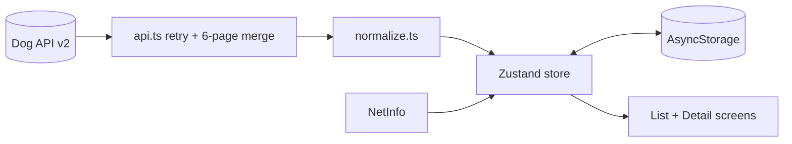

# Tripare Dog Breeds

Offline-first Dog Breed Explorer. React Native (bare CLI) + TypeScript (strict), data from [Dog API v2](https://dogapi.dog/docs/api-v2).

## Quick start

This repo contains the app source (`App.tsx`, `src/`, `docs/`). The native iOS/Android projects are generated once by the official React Native CLI:

```bash
bash scripts/bootstrap.sh    # generates ios/ android/, installs deps (+ pods on macOS)
cp .env.example .env
npm run ios                  # or: npm run android
npm test
```

Needs Node 18+, Xcode (iOS) or Android Studio (Android), per the [React Native environment setup](https://reactnative.dev/docs/set-up-your-environment).

## Architecture overview

The app is cache-first. On launch the store loads saved breeds from AsyncStorage so the list appears instantly, then syncs in the background if the data is older than an hour. A sync fetches page 1 of `/breeds` (whose `meta.pagination` tells us how many pages exist), fetches the rest in parallel, merges by id, and writes to the store and to storage. Requests use exponential backoff; if some pages fail we keep what we have, merge what succeeded, and show an error banner rather than losing data.

All UI reads from a Zustand store that holds breeds and groups in normalized, id-keyed maps. Search, filters and grouping are pure functions over that in-memory data (`src/filters.ts`), so they are instant and work offline. NetInfo tracks connectivity and triggers a sync when the network returns.



Details: [docs/ARCHITECTURE.md](docs/ARCHITECTURE.md).

## Key technical decisions

- **State: Zustand.** Minimal, selector-based, usable outside React, normalized entity maps.
- **Database: AsyncStorage, one key per breed.** Data is small and read-mostly; queries run in memory. Per-breed keys avoid Android's ~2MB single-value limit.
- **Offline sync:** cache-first render, background sync when stale, sync on reconnect, pull-to-refresh, "Last synced X ago" banner, partial-failure handling.
- **Images:** `thumb` in the list, `medium` on the detail overview, `large` only in the gallery; attribution (author/license/source) shown under every gallery image.

Full rationale, schema, and the rich-rows performance trade-off: [docs/DECISIONS.md](docs/DECISIONS.md).

## Features

- Debounced search on name and other names
- Multi-select filters: breed group, size band, coat length, hypoallergenic, "good with" trait threshold (4+)
- List grouped by breed group, pull-to-refresh, light/dark mode
- Detail tabs: Overview, Traits (visual scales + temperament chips), Gallery (swipeable, with attribution)

## Performance report

See [docs/PERFORMANCE.md](docs/PERFORMANCE.md) for bundle size, profiler and memory screenshots, and FPS. (Measured values go there.)

## Screenshots

Add to `docs/img/`: list (light + dark), filters applied, detail with traits and gallery, offline banner.
