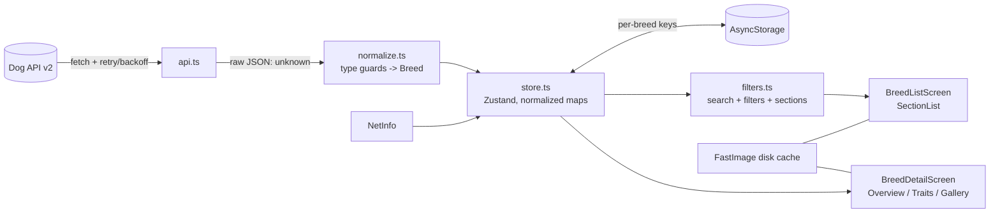

# Architecture

## Layers

## Data flow: API -> cache -> UI

1. **Launch**: `store.init()` loads AsyncStorage into the store, so the list renders immediately from cache (no network wait). `hydrated` flips to true.
2. If the cache is empty or older than 1 hour and we're online, `sync()` runs in the background.
3. `sync()` calls `fetchAllBreeds()`: page 1 first (its `meta.pagination.last` says how many pages exist), then the rest in parallel, merged and de-duplicated by id. Groups are fetched alongside.
4. Results replace (full success) or are upserted into (partial failure) the normalized store, then persisted.
5. Screens read from the store only. They never call the API directly, except the detail screen's single-breed refresh, which goes through `store.refreshBreed(id)`.
6. **Offline -> online**: `useNetworkSync` (NetInfo) sets `isOffline`, and triggers `sync()` on the offline->online transition.

## Failure handling

| Situation | Behaviour |
|---|---|
| No network at launch | Cached data shown, "Offline" banner + last-synced time |
| A request fails | Exponential backoff (500ms, 1s, 2s); 4xx other than 429 are not retried |
| Page 1 fails | Sync fails, cached data stays, error banner + Retry |
| Some later pages fail | Successful pages are merged into the cache, banner says "N of M pages failed", `lastSyncedAt` is NOT advanced |
| Groups fail | Breeds still update; banner notes groups are stale |
| Render crash | Per-feature `ErrorBoundary` (list, detail, app) with "Try again" |
| Corrupt cache record | Skipped on load, restored by the next sync |

## Modules

- `types.ts` domain types (a flat `Breed`, not the JSON:API envelope)
- `normalize.ts` `unknown` -> `Breed` using type guards (`utils/guards.ts`); derives `sizeBand`
- `api.ts` fetch, retry, 6-page merge
- `storage.ts` AsyncStorage persistence
- `store.ts` Zustand store (entities, sync state, filters)
- `filters.ts` pure functions: search, filters, grouping (fully unit-tested)
- `screens/`, `components/` UI
